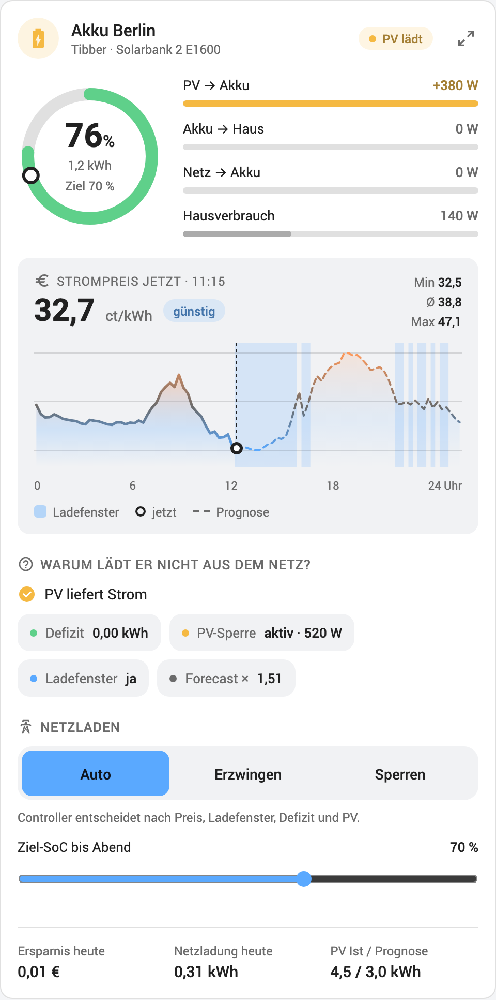
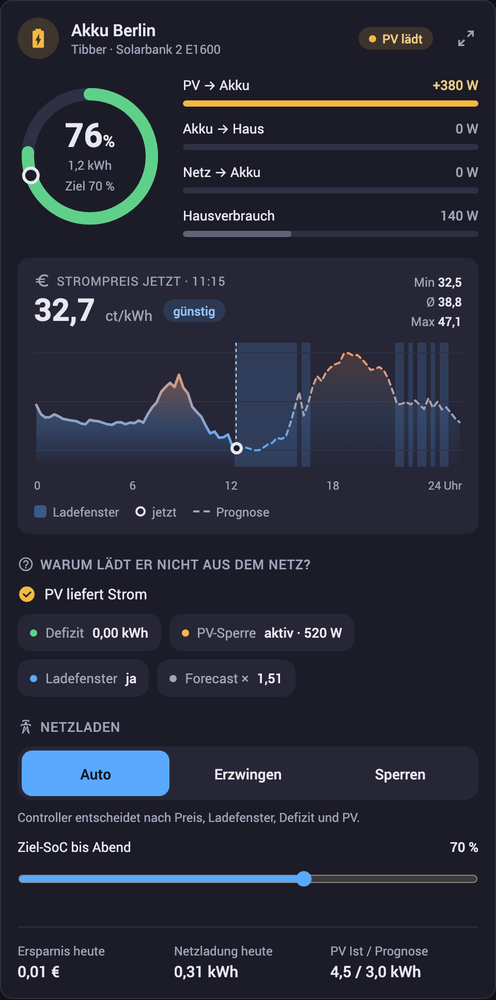
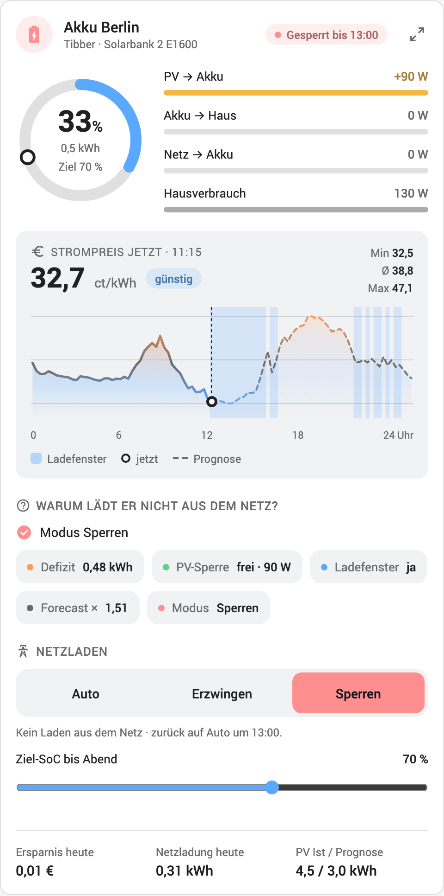
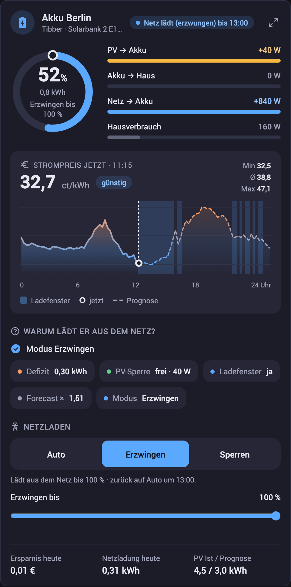
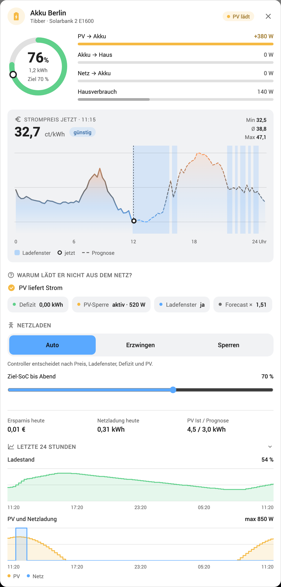

# Tibber Battery Card

[](https://my.home-assistant.io/redirect/marketplace_repository/?owner=hoentaex&repository=ha-tibber-battery-card&category=plugin)
[](https://github.com/hoentaex/ha-tibber-battery-card/releases/latest)
[](https://github.com/hoentaex/ha-tibber-battery-card/actions/workflows/validate.yml)
[](https://github.com/hoentaex/ha-tibber-battery-card/actions/workflows/hacs.yml)
[](LICENSE)

**[Deutsch](#deutsch) · [English](#english)**

| Hell / Light | Dunkel / Dark |
|---|---|
|  |  |

---

## Deutsch

Lovelace-Karte für einen **Heimspeicher mit dynamischem Stromtarif (Tibber)**, gebaut für eine
**Anker SOLIX Solarbank** – funktioniert aber mit jedem Akku, dessen Werte als Entities in Home Assistant vorliegen.

Auf einen Blick: Wie voll ist der Akku, woher kommt gerade Energie, wie teuer ist Strom heute im
15-Minuten-Takt, **warum** wird gerade (nicht) aus dem Netz geladen – und der Lademodus lässt sich direkt umschalten.

Aufbau und Look orientieren sich an den Karten von [juju35](https://github.com/juju35) und an der
[Proxmox Card](https://github.com/hoentaex/ha-proxmox-card).

> [!WARNING]
> **Privates Hobbyprojekt.** Die Karte ist für meine eigene Installation entstanden und wird in der Freizeit gepflegt.
> Es gibt keine Gewährleistung und keinen Support: **Die Nutzung erfolgt auf eigene Gefahr.**
> Die Karte schaltet Helfer (`input_select`, `input_number`), die bei dir echte Lade-Automationen steuern können –
> prüfe, was deine Automationen daraus machen, bevor du sie bedienst.

### Was die Karte macht – und was nicht

- **Zeigt an:** Ladestand mit Ziel-SoC-Markierung, kWh im Akku, Energieflüsse (PV → Akku, Akku → Haus, Netz → Akku,
  Hausverbrauch, aktive Flüsse animiert), Strompreis jetzt mit günstig / mittel / teuer, Min / Ø / Max,
  Preisverlauf über 96 Viertelstunden (92 / 100 bei Zeitumstellung) mit Ladefenster, Gründe fürs (Nicht-)Laden
  samt der aktuellen Entscheidung deines Controllers, Ablaufzeit von Erzwingen / Sperren, Ersparnis, Netzladung und
  PV heute.
- **Setzt:** den Modus-Helfer (Auto / Erzwingen / Sperren), den Ziel-SoC-Helfer und im Modus Erzwingen dessen
  eigenen Ziel-SoC.
- **Entscheidet nichts.** Es gibt **keine Steuerlogik** in der Karte. Ob und wann aus dem Netz geladen wird,
  entscheiden **deine** Automationen in Home Assistant. Ohne solche Automationen verändern die Schalter nur die Helfer.

### Was du brauchst

| Baustein | Wofür | Pflicht? |
|---|---|---|
| Home Assistant 2024.8 oder neuer | | ja |
| Ein Ladestand-Sensor in % (z. B. aus der [Anker-SOLIX-Integration](https://github.com/thomluther/ha-anker-solix)) | Ring | **ja** – das ist die einzige Pflicht-Entity |
| Die [Tibber-Integration](https://www.home-assistant.io/integrations/tibber/) **oder** ein Preissensor mit 15-Minuten-Preisen als Attribute | Preisdiagramm | für den Preisbereich |
| Leistungssensoren: Akkuleistung, PV, Netzladung, Hausverbrauch (W oder kW) | Flussbalken, Status | empfohlen |
| `input_select` mit drei Optionen, z. B. `auto` / `erzwingen` / `sperren` | Modus-Schalter | optional |
| `input_number` für den Ziel-SoC (min / max / step werden übernommen) | Schieber, Ring-Markierung | optional |
| `input_number` für den Ziel-SoC beim Erzwingen | Schieber und Ring im Modus Erzwingen | optional |
| `input_datetime` (Datum + Uhrzeit) oder Sensor mit `device_class: timestamp`, in dem deine Automation das Ende von Erzwingen / Sperren ablegt | „Gesperrt bis 13:00“, „zurück auf Auto um …“ | optional |
| `input_text` (oder Sensor), in den dein Controller den Grund seiner Entscheidung schreibt | Entscheidungszeile über den Chips | optional |
| `input_number` oder Wert `capacity_kwh` für die Akkukapazität | kWh unter dem Ring | optional |
| Weitere Sensoren für Defizit, PV-Sperre, Ladefenster, Forecast-Faktor, Ersparnis, Netzladung, PV heute / Prognose | Chips und Fußzeile | optional |
| **Eigene Automationen**, die Modus und Ziel-SoC auswerten und z. B. die Netzladung der Solarbank schalten | das eigentliche Laden | für eine echte Steuerung |

Fehlt eine Entity oder ist sie `unavailable`, blendet die Karte den zugehörigen Wert, Chip oder Abschnitt aus –
sie bricht nie komplett.

Helfer anlegen: **Einstellungen → Geräte & Dienste → Helfer → Helfer erstellen** → *Dropdown* (Optionen
`auto`, `erzwingen`, `sperren`) bzw. *Zahlenwert* (Ziel-SoC 20–100 %, Kapazität in kWh).

### Preise

**Reihenfolge:** Ist `price_entity` gesetzt, liest die Karte die Preise aus dessen Attributen (kein Service-Aufruf).
Sonst ruft sie `tibber.get_prices` selbst über die Tibber-Integration auf (heute + morgen), speichert das Ergebnis
zwischen und lädt nur bei Tageswechsel bzw. ab 13 Uhr einmal pro Viertelstunde nach, bis die Preise für morgen da sind.
Bei mehreren Zuhause wählt `tibber_home` das richtige (Standard: das erste).

Empfohlen ist ein triggerbasierter Template-Sensor, den auch deine Automationen nutzen können – dann sehen Karte und
Steuerung garantiert dasselbe Ladefenster:

| Feld | Inhalt |
|---|---|
| Zustand | Preis der aktuellen Viertelstunde (EUR/kWh) |
| `today` / `tomorrow` | Liste `{start_time, price}`, 96 Slots pro Tag (92 / 100 bei Zeitumstellung) |
| `min_today` / `max_today` / `avg_today` | Tageskennzahlen (sonst rechnet die Karte selbst) |
| `ladefenster` | Startzeiten der 24 günstigsten der nächsten 48 Viertelstunden |

```yaml
template:
  - trigger:
      - trigger: time_pattern
        minutes: /15
      - trigger: homeassistant
        event: start
    action:
      - action: tibber.get_prices
        data:
          start: "{{ today_at().isoformat() }}"
          end: "{{ (today_at() + timedelta(days=2)).isoformat() }}"
        response_variable: resp
      - variables:
          p: >
            
            
            
            
              
              
              
              
            
            
            {{ {
              'now': ns.now,
              'today': ns.today,
              'tomorrow': ns.tomorrow,
              'min': prices | min if prices else none,
              'max': prices | max if prices else none,
              'avg': (prices | sum / prices | count) | round(4) if prices else none,
              'ladefenster': (ns.next[:48] | sort(attribute='price'))[:24]
                | sort(attribute='start_time') | map(attribute='start_time') | list,
            } }}
    sensor:
      - name: Tibber Preise 15min
        unique_id: tibber_preise_15min
        unit_of_measurement: EUR/kWh
        state: "{{ p.now }}"
        attributes:
          today: "{{ p.today }}"
          tomorrow: "{{ p.tomorrow }}"
          min_today: "{{ p.min }}"
          max_today: "{{ p.max }}"
          avg_today: "{{ p.avg }}"
          ladefenster: "{{ p.ladefenster }}"
```

```yaml
price_entity: sensor.tibber_preise_15min
```

Feldnamen sind einstellbar (`price_time_key`, `price_value_key`, `price_today_attribute`, `price_tomorrow_attribute`),
damit auch andere Quellen (Nordpool o. Ä.) passen. Preise unter 5 werden als €/kWh gelesen, alles darüber als ct/kWh.

**Ladefenster – ein mitlaufendes Fenster wie in der Steuerung:** die `cheap_slots` günstigsten (Standard 24) der
nächsten `window_horizon_slots` Viertelstunden (Standard 48) ab dem aktuellen Slot, also „6 h aus den nächsten 12 h“.
Es läuft mit der Uhr mit und reicht über Mitternacht in den Folgetag, sobald die Morgenpreise da sind; fehlen sie,
nimmt die Karte die günstigsten `min(24, verfügbare)`. Hat der Preissensor ein Attribut `ladefenster` (Liste von
Startzeiten, Name über `window_attribute` änderbar), übernimmt die Karte genau diese Slots und rechnet nicht selbst.
Gezeichnet wird es als halbtransparente Blöcke über die volle Diagrammhöhe; Blöcke in den Folgetag erscheinen nur
mit `show_tomorrow: true`. Der Chip „Ladefenster ja/nein“ zeigt, ob der aktuelle Slot im Fenster liegt.

> Tipp: Große Attribute nicht in der Datenbank speichern – `recorder: exclude: entities: [sensor.tibber_preise_15min]`.

### Installation

**Über den Marketplace (HACS):**

[](https://my.home-assistant.io/redirect/marketplace_repository/?owner=hoentaex&repository=ha-tibber-battery-card&category=plugin)

oder von Hand: **Marketplace → ⋮ → Benutzerdefinierte Repositories** → `https://github.com/hoentaex/ha-tibber-battery-card`,
Typ **Dashboard** → *Tibber Battery Card* installieren → Browser neu laden.

**Manuell:** `ha-tibber-battery-card.js` aus dem [letzten Release](https://github.com/hoentaex/ha-tibber-battery-card/releases/latest)
nach `/config/www/` kopieren, unter **Einstellungen → Dashboards → ⋮ → Ressourcen** `/local/ha-tibber-battery-card.js`
als **JavaScript-Modul** eintragen, Browser neu laden.

### Konfiguration

Minimal:

```yaml
type: custom:tibber-battery-card
soc_entity: sensor.solarbank_2_e1600_ac_ladestand
```

Vollständig (Beispiel mit Anker Solarbank 2 E1600 AC):

```yaml
type: custom:tibber-battery-card
name: Akku Berlin
subtitle: Tibber · Solarbank 2 E1600
soc_entity: sensor.solarbank_2_e1600_ac_ladestand
capacity_entity: input_number.tibber_anker_capacity_kwh
battery_power_entity: sensor.solarbank_2_e1600_ac_akkuleistung
pv_power_entity: sensor.solarbank_2_e1600_ac_solarleistung
grid_charge_power_entity: sensor.solarbank_2_e1600_ac_netzaufladung
house_power_entity: sensor.solarbank_2_e1600_ac_hausbedarf
grid_charge_switch: switch.solarbank_2_e1600_ac_notladeoption
mode_entity: input_select.tibber_netzlade_modus
target_soc_entity: input_number.tibber_target_evening_soc
force_target_soc_entity: input_number.tibber_erzwingen_ziel_soc
override_until_entity: input_datetime.tibber_override_ablauf
reason_entity: input_text.tibber_netzlade_grund
deficit_entity: sensor.tibber_energie_defizit_heute_kwh
pv_block_entity: binary_sensor.pv_berlin_erzeugung_aktiv
window_entity: sensor.tibber_aktuell_in_top6_gunstig_heute
forecast_factor_entity: sensor.pv_forecast_korrekturfaktor_berlin
savings_today_entity: sensor.tibber_ersparnis_heute
grid_kwh_today_entity: input_number.tibber_grid_charge_kwh_today
pv_today_entity: sensor.pv_power_from_solar_daily
pv_forecast_today_entity: sensor.energy_production_today
```

| Option | Bedeutung | Standard |
|---|---|---|
| `name`, `subtitle` | Titel und Untertitel | „Heimspeicher“ |
| `soc_entity` | Ladestand in % | – |
| `capacity_entity` / `capacity_kwh` | Akkukapazität in kWh | – |
| `battery_power_entity` | Akkuleistung, + laden / − entladen | – |
| `invert_battery_power` | Vorzeichen der Akkuleistung umdrehen | `false` |
| `pv_power_entity`, `grid_charge_power_entity`, `house_power_entity` | PV-, Netzlade- und Hausleistung | – |
| `grid_charge_switch` | Netzladen an/aus (für die Status-Pill) | – |
| `mode_entity` | Modus-Helfer (`input_select`) | – |
| `mode_options` | Optionsnamen des Helfers | `{auto: auto, force: erzwingen, block: sperren}` |
| `target_soc_entity` | Ziel-SoC (`input_number`) | – |
| `force_target_soc_entity` | Ziel-SoC für Erzwingen (`input_number`); im Modus Erzwingen steuert der Schieber diesen Wert („Erzwingen bis“), und der Ring zeigt ihn als Ziel | – |
| `override_until_entity` | Ablauf von Erzwingen / Sperren (`input_datetime` mit Datum + Uhrzeit oder Timestamp-Sensor); liegt er in der Vergangenheit, wird keine Uhrzeit gezeigt | – |
| `reason_entity` | Klartext-Grund der aktuellen Entscheidung (`input_text` oder Sensor), als Zeile über den Chips | – |
| `deficit_entity`, `pv_block_entity`, `window_entity`, `forecast_factor_entity` | Chips „Warum lädt er (nicht)?“ (`window_entity` nur, wenn es kein Preisfenster gibt) | – |
| `savings_today_entity`, `grid_kwh_today_entity`, `pv_today_entity`, `pv_forecast_today_entity` | Fußzeile | – |
| `price_entity` | Preise aus Attributen statt `tibber.get_prices` | – |
| `price_today_attribute`, `price_tomorrow_attribute` | Attributnamen | `today`, `tomorrow` |
| `price_time_key`, `price_value_key` | Feldnamen je Eintrag | `start_time`, `price` |
| `window_attribute` | Attribut mit fertigem Ladefenster im Preissensor | `ladefenster` |
| `tibber_home` | Zuhause bei `tibber.get_prices` | erstes |
| `cheap_slots` | Ladefenster: Anzahl günstigster Viertelstunden | `24` |
| `window_horizon_slots` | Ladefenster: Horizont in Viertelstunden ab jetzt | `48` |
| `show_tomorrow` | Morgen-Preise anhängen, sobald da | `false` |
| `sections` | Reihenfolge / Auswahl: `header`, `battery`, `price`, `reasons`, `controls`, `footer` | alle |
| `animations` | Flussanimation (respektiert `prefers-reduced-motion`) | `true` |
| `show_history` | 24-h-Verlauf (Ladestand, PV und Netzladung) auch in der normalen Karte, unter der Tagesbilanz | `false` |
| `history_collapsed` | 24-h-Verlauf startet eingeklappt; ein Klick auf die Überschrift klappt ihn auf (erst dann werden die Daten geladen) | `false` |
| `popup` | Detailansicht als Dialog (Hauptkarte: Button im Kopf; Mini-Karte: `false` = an Ort und Stelle aufklappen) | Hauptkarte `false`, Mini-Karte `true` |
| `language` | `de` / `en` | Sprache von Home Assistant |

**Status-Pill:** Modus-Helfer zuerst (*Gesperrt bis 13:00*, *Netz lädt (erzwungen) bis 13:00*, bei ausgeschaltetem
Netzlade-Switch *Erzwungen · Ziel erreicht*), dann Netzlade-Switch bzw. Netzladeleistung (*Netz lädt*), dann das
Vorzeichen der Akkuleistung (*PV lädt*, *Akku versorgt Haus*), sonst *Bereit*. Auf schmalen Karten kürzt die Pill auf
*Gesperrt* / *Erzwungen*; die Uhrzeit steht dann im Tooltip.

**Erzwingen und Sperren mit Ablaufzeit:** Setzt deine Automation beim Moduswechsel einen Ablaufzeitpunkt (z. B. jetzt
+ 3 h) in `override_until_entity`, zeigt die Karte unter dem Modus-Schalter etwa „Kein Laden aus dem Netz · zurück auf
Auto um 13:00.“ (morgen: „morgen 06:00“, später mit Datum). Schreibt dein Controller seine Entscheidung in
`reason_entity` („Modus Sperren“, „PV liefert Strom“, „Günstiges Ladefenster, Defizit 0.9 kWh“ …), steht sie über den
Chips; die Überschrift folgt dem Netzlade-Switch („Warum lädt er (nicht) aus dem Netz?“). Beides aktualisiert sich mit
den normalen Zustandsänderungen, ohne eigene Abfragen.

| Gesperrt bis 13:00 | Erzwingen bis 100 % |
|---|---|
|  |  |

### Mini-Karte und Detailansicht

`custom:tibber-battery-mini-card` zeigt alles Wichtige in einer Zeile: Ladestand-Ring, Name, Status, Preis mit
Einstufung, PV-Leistung und Ziel-SoC. Der Button rechts öffnet die **Detailansicht** als Vollbild-Dialog: die ganze
Karte mit großem Preisdiagramm und dem **Verlauf der letzten 24 Stunden** (Ladestand, PV-Leistung, Netzladung aus der
Home-Assistant-Historie). Mit `popup: false` klappt die Mini-Karte stattdessen die ganze Karte an Ort und Stelle auf.

Die Hauptkarte bekommt mit `popup: true` denselben Detail-Button im Kopf. Mit `show_history: true` zeigt sie die
beiden Verlaufsgrafiken auch ohne Popup direkt unter der Tagesbilanz. Die Überschrift „Letzte 24 Stunden“ klappt den
Bereich auf und zu; mit `history_collapsed: true` startet er eingeklappt (in der Karte und im Popup).

```yaml
type: custom:tibber-battery-mini-card
name: Akku Berlin
soc_entity: sensor.solarbank_2_e1600_ac_ladestand
# … dieselben Optionen wie die Hauptkarte
```

| Mini-Karte | Detailansicht |
|---|---|
| <br> |  |

### Visueller Editor

Beide Karten lassen sich komplett im visuellen Editor einrichten: Entity-Auswahl je Option (nach Domain gefiltert),
Gruppen für Akku, Steuerung, Gründe, Tagesbilanz, Preise und Darstellung, und ein einklappbarer Bereich **Erweitert**
für Modus-Optionsnamen, Tibber-Zuhause und Feldnamen der Preisquelle. Optionen mit Standardwert landen nicht im YAML.

Beim Hinzufügen einer neuen Karte sucht sie selbst nach einem Ladestand-Sensor (`*_ladestand`, `*_soc`,
`*_state_of_charge` oder `device_class: battery`), seinen Geschwister-Sensoren der Anker-SOLIX-Integration
(Akku-, Solar-, Netzlade- und Hausleistung), einem `input_select` mit `auto` als Modus-Helfer, einem
Ziel-SoC-`input_number` (eines mit `erzwingen` / `force` im Namen wird zum Erzwingen-Ziel), einem `input_datetime`
mit `override` / `ablauf` im Namen, einem `input_text` mit `grund` / `reason` im Namen und einem Preissensor mit
`today`-Attribut. Ohne Preissensor wird automatisch das erste
Tibber-Zuhause verwendet.

---

## English

A Lovelace card for a **home battery on a dynamic electricity tariff (Tibber)**, built for an **Anker SOLIX Solarbank**
but usable with any battery whose values exist as Home Assistant entities: state of charge, energy flows, today's
15-minute prices with the charging window, why it is (not) charging from the grid, and a grid-charge mode switch.

> [!WARNING]
> **This is a private hobby project**, built for my own installation and maintained in spare time. It comes without
> any warranty or support: **use it at your own risk.** The card sets helpers (`input_select`, `input_number`) that may
> drive real charging automations in your setup.

**The card contains no control logic.** It only shows states and sets the mode and target SoC helpers; your own
automations decide when to charge from the grid.

**Force / Block with an end time, and the controller's reason:** three optional entities show what your controller
does. `force_target_soc_entity` (`input_number`) is the target while forcing: the slider then sets it ("Force up to")
and the ring marks it. `override_until_entity` (`input_datetime` with date and time, or a timestamp sensor) holds when
Force / Block falls back to Auto: the pill reads "Blocked until 13:00" / "Grid charging (forced) until 13:00" (short
"Blocked" / "Forced" on narrow cards, time in the tooltip) and the hint "No charging from the grid · back to Auto at
13:00."; a time in the past is not shown. `reason_entity` (`input_text` or sensor) is shown as a decision line above
the chips. With Force on and the grid switch off, the pill reads "Forced · target reached".

**Charging window:** a rolling window like the HA control logic: the `cheap_slots` cheapest (24) of the next
`window_horizon_slots` quarter hours (48) from the current slot, running past midnight once tomorrow's prices are
known. A `ladefenster` attribute on the price sensor (`window_attribute`) is used as is.

**You need:** Home Assistant 2024.8+, a state-of-charge sensor (the only required entity), and for prices either the
[Tibber integration](https://www.home-assistant.io/integrations/tibber/) (the card calls `tibber.get_prices` itself and
caches the result) or a sensor carrying the 15-minute prices as attributes (see the template example above). Power
sensors, an `input_select` with three options, an `input_number` for the target SoC and the other sensors are optional;
anything missing or unavailable is simply hidden.

**Visual editor:** both cards can be set up entirely in the UI editor; new cards try to find the battery, its
Anker SOLIX sibling sensors, the mode and target helpers and a price sensor by themselves.

**Install** through the Marketplace (HACS) as a custom repository of type *Dashboard*, or copy
`ha-tibber-battery-card.js` from the latest release to `/config/www/` and add it as a JavaScript module resource.

**Configure** with the options in the table above (all names are the same in English); minimal config:

```yaml
type: custom:tibber-battery-card
soc_entity: sensor.my_battery_soc
```

**Mini card:** `custom:tibber-battery-mini-card` takes the same options and shows one row (ring, name, status, price,
PV, target); its button opens the detail dialog with a large price chart and the last 24 hours of SoC, PV and grid
charging (`popup: false` expands the full card in place instead). `popup: true` adds the same button to the main card; `show_history: true` shows the two history charts in the
card itself; its heading folds the section, and `history_collapsed: true` starts it folded.

Mode option names are configurable through `mode_options` (`{auto: auto, force: force, block: block}` for English helpers).

## Development

```bash
npm install
npm run check        # Biome lint, build, syntax check
npm test             # data layer tests (node:test)
npm run demo         # demo page with a fake hass on http://127.0.0.1:8768/demo/
npm run screenshots  # README screenshots (Playwright)
```

Releases: bump `version` in `package.json`, add its `CHANGELOG.md` section, push a tag `vX.Y.Z`.

## License

[MIT](LICENSE)
